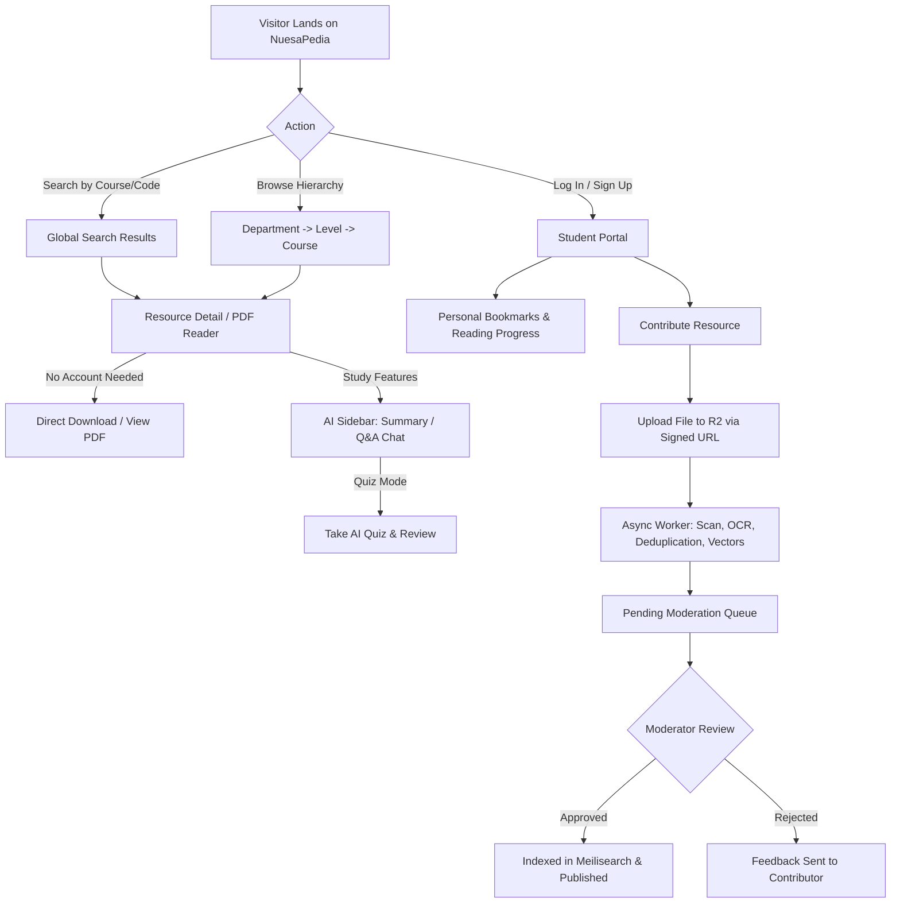
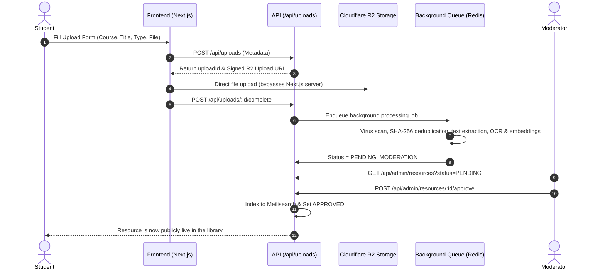

# NuesaPedia — Complete User Flows & Architecture

**Project:** NuesaPedia (Digital Faculty Library)  
**Version:** 1.0  
**Target Audience:** Engineering Undergraduates, Researchers, Faculty Members & Moderators  
**Faculty:** Faculty of Engineering (FUOYE / NUESA)  
**Architecture:** Next.js App Router + PostgreSQL + Prisma + Cloudflare R2 + Meilisearch + Upstash Redis + OpenAI (RAG)  

---

# 1. High-Level User Flow Architecture



---

# 2. Detailed Breakdown of Core User Flows

## Flow 1: Public Discovery & Instant Access (Zero-Barrier Guest)
> **Goal:** Get past questions, lecture slides, or textbooks into the student's hands in under 15 seconds without forcing registration.

1. **Entry Points:**
   * **Global Search Bar:** Student types `MEE 302` or `Fluid Mechanics`. Instant search results show matching titles, course codes, and resource types powered by Meilisearch.
   * **Departmental Browse Hierarchy:** Homepage → Select Department (e.g. *Electrical & Electronics*) → Select Level (*300L*) → Select Course (*EEE 314*) → Filter by type (*Past Questions* / *Textbooks* / *Lecture Notes*).
2. **Instant Download:**
   * Student clicks `Download` on any resource card.
   * The API generates a temporary signed Cloudflare R2 URL (`GET /api/resources/:id/download`).
   * Browser initiates download immediately while incrementing the download counter in PostgreSQL.
3. **In-Browser Reading:**
   * Student clicks `Read Online`.
   * Launches the PDF.js reader with dark mode, zoom, search, and page jump capabilities.
4. **PWA Offline Save:**
   * When installed on a mobile device or tablet, the document can be saved to IndexedDB for offline reading without an active internet connection.

---

## Flow 2: In-Depth Study & AI Revision Flow
> **Goal:** Empower students to digest voluminous engineering textbooks and prepare for exams interactively.

1. **Document AI Summary:**
   * While reading in the PDF viewer, the student toggles the **AI Sidebar**.
   * Student clicks `Generate Summary` (`POST /api/ai/summary`).
   * The AI returns:
     * **Key Concepts:** Bulleted conceptual takeaways.
     * **Core Formulas:** High-yield equations and definitions.
     * **Exam Tips:** Advice on common pitfalls and testable points.
2. **Document Q&A Chat (RAG):**
   * Student asks a document-specific question (e.g., *"Derive the formula for Bernoulli's equation in section 3"*).
   * Pipeline:
     ```text
     Student Question
           ↓
     Generate Query Embedding
           ↓
     pgvector Similarity Search (Top-k Chunks)
           ↓
     Context-Injected Prompt to OpenAI
           ↓
     Synthesized Answer + Exact Page Number Citations
     ```
   * The AI responds citing the exact page numbers from the lecturer's material.
3. **Interactive AI Quiz:**
   * Student selects `Generate Quiz` (e.g., 10 MCQs, timed).
   * Questions and multiple-choice options are served **without answers**.
   * Student submits answers (`POST /api/ai/quiz/:id/submit`).
   * System evaluates score, displays detailed explanations for every option, and highlights areas needing review.

---

## Flow 3: Student Contribution Flow (Upload Pipeline)
> **Goal:** Crowdsource verified course materials and past questions safely without overloading the web server.



1. **Initiate Upload:** Student logs in via NextAuth and navigates to `/upload`.
2. **Metadata & Pre-sign:** Student inputs Title, Course Code, and Resource Type. API validates with Zod and returns a signed Cloudflare R2 upload URL.
3. **Direct Upload:** The browser streams the PDF directly to R2 storage, preventing 50MB+ textbooks from bogging down the server.
4. **Background Processing Pipeline:**
   * Virus scan & MIME type validation.
   * Cryptographic hash (`SHA-256`) check to detect and reject duplicate files.
   * Text extraction and OCR for scanned documents.
   * Semantic chunking and vector embedding generation stored in `pgvector`.
5. **Moderator Review:** Resource is placed in `PENDING` queue for editorial review.

---

## Flow 4: Personalized Student Experience (Authenticated)
> **Goal:** Retain user state across mobile and desktop devices.

* **Reading Progress Sync:** Automatically tracks current page number and percentage completion (`PUT /api/resources/:id/progress`). When reopening the app, the student resumes right where they stopped.
* **Bookmarks Vault:** One-click bookmarking of favorite courses, syllabi, and reference textbooks.
* **My Contributions Dashboard:** Real-time visibility into submitted materials:
  * `PROCESSING`: Extracting text and generating vectors.
  * `PENDING`: Awaiting moderator sign-off.
  * `APPROVED`: Published and live for the faculty.
  * `REJECTED`: Includes feedback note explaining why it was declined.

---

## Flow 5: Moderation & Quality Assurance Workflow
> **Goal:** Maintain high academic integrity and eliminate spam/malicious uploads.

1. **Review Dashboard (`/admin/resources`):**
   * Accessible by users with `MODERATOR` or `ADMIN` roles.
   * Lists all `PENDING` submissions with contributor info, timestamp, course tag, file size, and duplicate flags.
2. **Inspection:**
   * Moderator previews the uploaded document in-browser.
   * Reviews OCR-extracted text and validates course relevance.
3. **Decision Action:**
   * **Approve:** Updates status to `APPROVED` → triggers Meilisearch indexing job → resource appears in global search and department shelves immediately.
   * **Reject:** Moderator enters a required rejection reason (e.g., *"Unclear scans, missing pages 4-10"*) → status set to `REJECTED` and contributor is notified.
   * **Edit Metadata:** Correct typos or update course codes prior to publishing.

---

## Flow 6: Offline & PWA Experience
> **Goal:** Reliable access under poor campus network conditions.

1. **Installation:** User installs NuesaPedia as a Progressive Web App directly from the browser onto Android/iOS/Desktop.
2. **App Shell Caching:** Service Worker automatically caches static assets, CSS, and essential navigation pages.
3. **Offline Document Storage:**
   * Downloaded documents and metadata are stored in browser **IndexedDB**.
   * A discreet offline status badge informs the student:
     `Offline Mode • Showing Downloaded Vault`
   * Students can read their downloaded textbooks and past question solutions without internet access.

---

# 3. Key UX Decisions Summary

| Decision | Rationale |
|---|---|
| **No login required for downloads** | Eliminates friction during exam periods when students have poor network and need materials quickly. |
| **Direct-to-R2 upload** | Prevents large 50MB+ engineering textbooks from overwhelming the Next.js server runtime. |
| **Document-scoped RAG for AI** | Ensures AI answers strictly match the lecturer's syllabus notes rather than hallucinating external theories. |
| **PWA & IndexedDB offline cache** | Tailored for campus connectivity constraints, allowing students to access cached PDFs anywhere. |
| **Single Faculty Structure** | Organizes content directly by Department → Level → Course without confusing multi-faculty selectors. |
